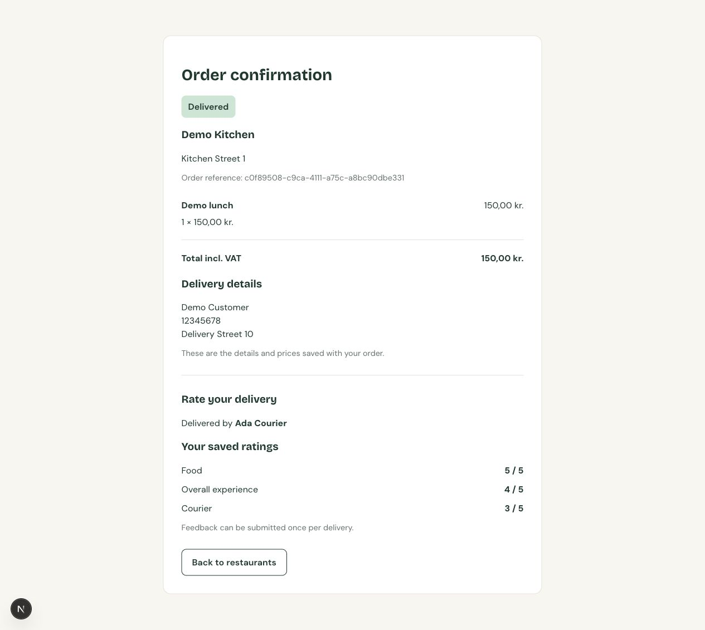

# Customer delivery feedback

[Frontend #18](https://github.com/EmilXavierVT/MTOGO-Front/issues/18) implements the React
part of [MTOGO #60](https://github.com/EmilXavierVT/MTOGO/issues/60).
Owner: @EmilXavierVT. Backend owns the default-off environment flag
`MTOGO_FEATURE_CUSTOMER_FEEDBACK`; the public capability is `customerFeedback`.

Inside the existing CUSTOMER role boundary, an explicit runtime `true` shows a list of
delivered orders on `/customer`. Each links to its saved order at `/customer/orders/{id}`.
Only a DELIVERED order offers the new feedback section. The existing order details remain
available regardless of capability loading/failure. Missing/unknown/malformed capabilities
and older backends fail closed without new browser build variables.

The section reads `GET /api/customer/orders/{id}/feedback`. The response includes the
persisted `orderId`, `deliveryId`, `courierId`, `courierName` and either `feedback: null`
or `{id, foodRating, overallExperienceRating, courierRating}`. Three required selects use
whole values 1–5. POST to the same path sends only those three rating fields, then displays
the saved result. Reloading reads that result without offering a second submission.
The customer's identity and courier assignment are never chosen by the browser.

All requests use the existing Bearer token and no-store caching. 401 clears tokens/roles
from both stores, removes private content and returns to login. 403 shows an access error;
409 on submission refreshes the saved state, covering duplicate tabs; 404 after a stale
enabled snapshot removes the action and explains that feedback is unavailable. A failed/lost
write response requires reading the saved state before another submission is offered.
Unmounting aborts requests and late reads cannot populate a different order. Pending saves
disable the form. Feedback does not change bonus and has no comments/moderation.

Deploy the backend contract first, then this repository through Takt. Production stays
default OFF until an explicit activation. Follow the
[backend migration/activation runbook](https://github.com/EmilXavierVT/MTOGO/blob/main/docs/customer-feedback.md)
for the database preflight, same-image OFF → ON → OFF recreation and Watchtower coordination.
Re-enter a page to refresh runtime capabilities; open pages have no instant update promise.

Remove the conditional after approved stable activation and the rollback window closes.
Keep returning the public capability as true while supported older clients still consume it.

`./scripts/check.sh quick` covers the enabled/saved form, disabled/premature states, entry
links, duplicate submission/reload, stale refusal, network recovery, expired sessions and
obsolete reads, alongside existing product/capability tests. `gh deliver` also builds the
production app.

## Local demonstration, 26 November 2026

All 96 frontend tests and 41 Takt tool tests passed, with lint and TypeScript checks.
The browser used the real local backend and an isolated PostgreSQL database: entered via
the delivered-order link, submitted 5/4/3 for the assigned courier and verified the saved
result after reload. Backend OFF → ON → OFF kept the same immutable image; after switching
off, the form and entry point disappeared while the order and ordering UI stayed available.
All five existing deployment smoke checks passed locally. This is enabled local evidence;
production remains default OFF.

